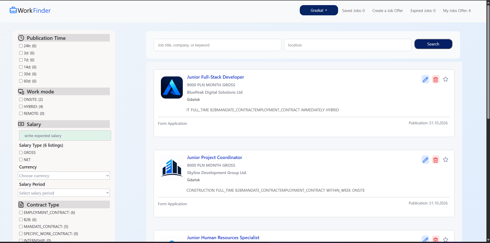
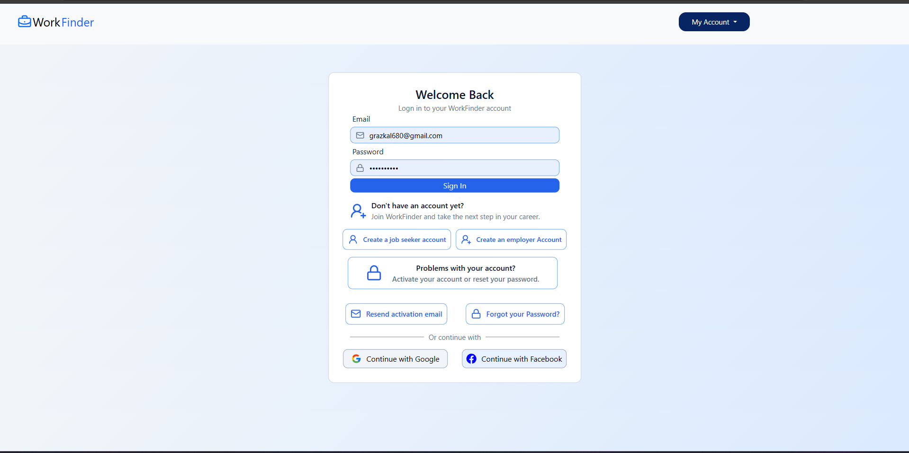
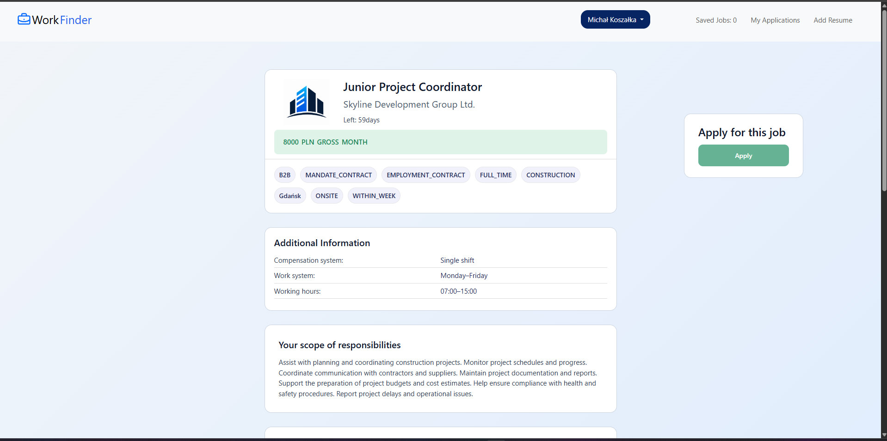
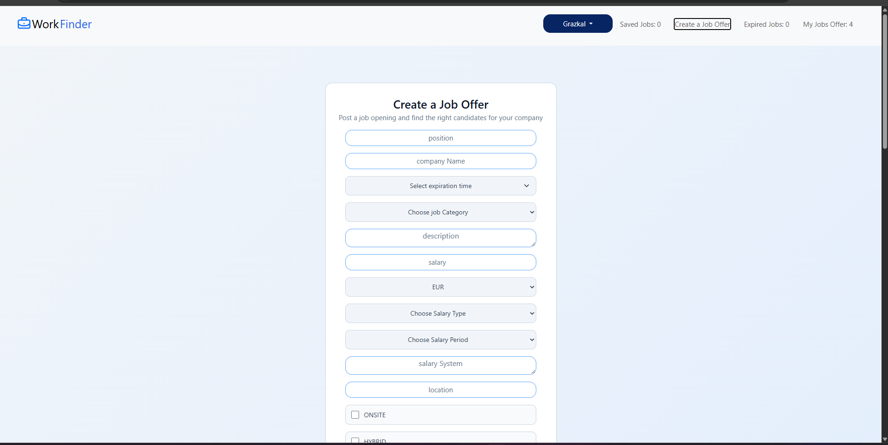
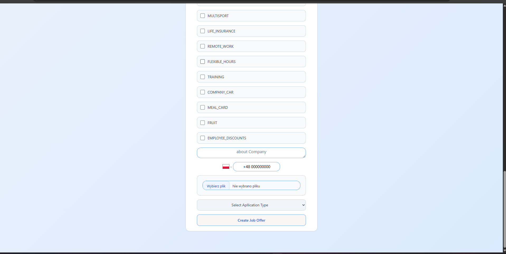
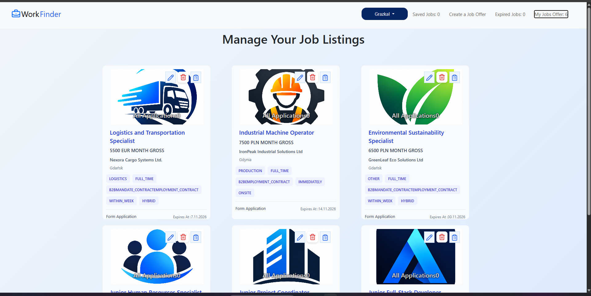
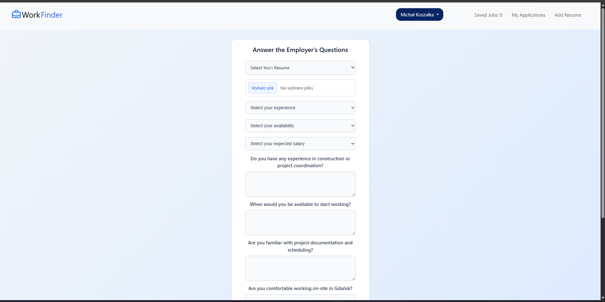
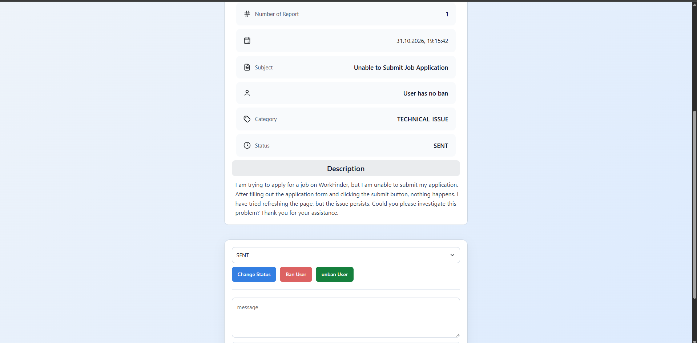

# WorkFinder – Job Portal Web Application

The application connects job seekers with employers and provides tools for managing job offers, applications,
and communication between users.

The platform includes user authentication and authorization, Google and Facebook OAuth2 login,
JWT-based authentication, email verification, password recovery, job offer management, customizable application forms,
CV uploads, saved jobs, and an administrative panel with user management and report handling.

## Key Features

### Authentication and Account Management
- Separate registration for job seekers and employers
- Login with email and password
- Google and Facebook OAuth2 authentication and account linking
- JWT-based authentication and authorization
- Email verification with the ability to resend verification emails
- Password recovery and password reset
- User account management and profile editing

### Job Seeker Features
- Browse job offers with extensive filtering and search options
- View detailed job descriptions
- Save job offers for later
- Submit applications using quick applications or custom application forms
- Upload and manage CV files
- View submitted applications and their details
- Manage personal account information
- Submit reports about problems
- View submitted reports and communicate with administrators through report conversations

### Employer Features
- Create and publish job offers
- View and manage personal job listings
- Edit existing job offers
- Soft-delete job offers
- View expired job offers
- Restore previously deleted job offers
- Configure application types and custom application questions
- View submitted applications and candidate information
- Review application answers and uploaded CVs
- Report problems and communicate with administrators through report conversations

### Administrative Features
- Automatically permanently delete soft-deleted job offers after a specified retention period using a scheduled background task
- Manage users and their accounts
- Ban and unban users
- View and manage reported issues
- Respond to reports and communicate with users
- Change report statuses
- View and manage job listings
- View deleted job offers
- Restore deleted job offers
- Permanently delete job offers
- Monitor reports and deleted job listings through administrative counters


## Tech Stack

### Backend
- Java 17
- Spring Boot 4
- Spring Web MVC – REST API development
- Spring Data JPA – data access
- Hibernate – ORM
- Spring Security – authentication and authorization
- Spring Validation – input validation
- Spring Mail – email notifications
- Spring Scheduling – scheduled background tasks
- Lombok – boilerplate code reduction
- Maven – dependency management and build automation

### Frontend
- React
- JavaScript
- HTML5
- CSS3
- Vite – frontend development and build tool

### Database
- MySQL

### Authentication and Security
- JWT (JSON Web Tokens)
- OAuth 2.0 / OpenID Connect
- Google OAuth2
- Facebook OAuth2
- Role-based access control
- Cloudflare Turnstile – CAPTCHA protection

### Integrations and File Handling
- Email verification and password recovery
- CV uploads using multipart/form-data

### Development Tools
- IntelliJ IDEA
- Visual Studio Code
- Git and GitHub
- MySQL Workbench
- npm

## Running the Application

### Backend
1. Open the project in IntelliJ IDEA.
2. Configure the database connection in `application.properties`.
3. Run the Spring Boot application from IntelliJ IDEA.

### Starting the Development Server
1. Open the terminal in IntelliJ IDEA.
2. Navigate to the `frontend` directory:
   ```bash
   cd frontend
   ```
3. Install dependencies:
   ```bash
   npm install
   ```
4. Start the development server:
   ```bash
   npm run dev
   ```
5. Open the local URL displayed in the terminal.


## Screenshots

### Main Page


### Login


### Job Details


### Create Job Offer




### Employer Job Listings


### Application Form


### Report Details
